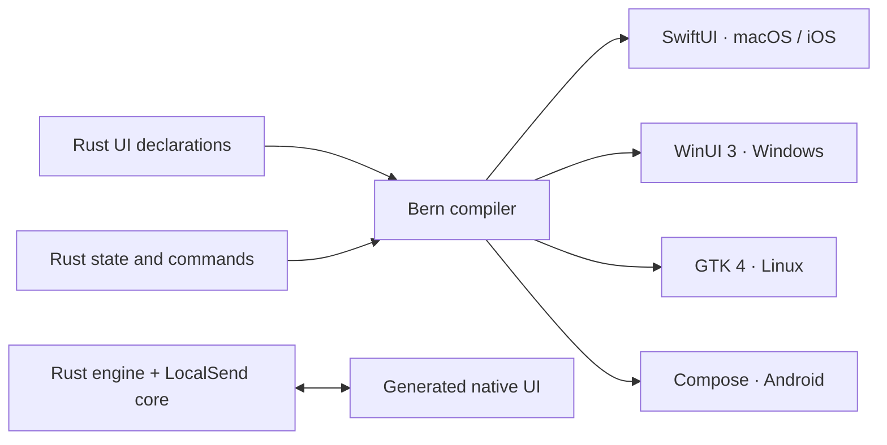

<div align="center">


<h1>RustSend</h1>

<p><b>A fully Rust native app for local file transfers.</b></p>

<p>Small packages. Low memory. High performance. Built with <a href="https://github.com/AimesSoft/Bern">Bern</a>, compatible with LocalSend.<br>
UI declarations, application logic, and file transfers written in Rust. Your files go directly between your devices.</p>

<p>

<a href="https://github.com/AimesSoft/Bern"></a>

</p>

<p>
<a href="https://github.com/AimesSoft/RustSend/releases"></a>
<a href="https://github.com/AimesSoft/RustSend/actions/workflows/ci.yml"></a>
<a href="LICENSE"></a>

</p>

<p><a href="README.md">简体中文</a> · <b>English</b></p>

<p>
<a href="https://github.com/AimesSoft/RustSend/releases/latest">Download</a> ·
<a href="#screenshots">Screenshots</a> ·
<a href="#why-rustsend">Why RustSend</a> ·
<a href="#measurements">Measurements</a> ·
<a href="#build-from-source">Build from source</a> ·
<a href="docs/releases/1.0.0.md">1.0 release notes</a>
</p>

</div>

## Screenshots

RustSend 1.0.0 running on all five platforms, with compact desktop windows and bottom navigation on phones. Click any image to view it at full size. These captures use the Chinese interface; English is also available.

<table>
<tr>
<th>macOS · SwiftUI</th>
<th>Windows · WinUI 3</th>
<th>Linux · GTK 4</th>
</tr>
<tr>
<td align="center"><a href="docs/screenshots/macos-receive.png"></a></td>
<td align="center"><a href="docs/screenshots/windows-receive.png"></a></td>
<td align="center"><a href="docs/screenshots/linux-receive.png"></a></td>
</tr>
</table>

<table>
<tr>
<th>Android · Jetpack Compose</th>
<th>iOS · SwiftUI</th>
</tr>
<tr>
<td align="center"><a href="docs/screenshots/android-receive.png"></a></td>
<td align="center"><a href="docs/screenshots/ios-receive.png"></a></td>
</tr>
</table>

macOS, Windows, and Android were captured on physical devices. Linux runs in an Ubuntu 24.04 ARM64 VM; iOS runs in the iPhone 17 Pro simulator. See the [gallery](docs/screenshots/README.md) for sending, receive approval, completion notifications, settings, and capture details.

## Why RustSend

| | What RustSend does |
| --- | --- |
| **Fully Rust** | UI declarations, state, commands, application logic, and the transfer core use Rust. Building requires neither Flutter nor Dart. |
| **Native UI with Bern** | Bern compiles Rust declarations into SwiftUI, WinUI 3, GTK 4, and Jetpack Compose interfaces. Buttons, forms, and pickers use platform controls. |
| **Small packages, low memory** | System UI, optimized Release builds, LTO, stripped symbols, and compact layouts that keep the current task in view. |
| **High-performance transfers** | Rust and Tokio handle network and disk operations asynchronously. Files and SHA-256 checksums are streamed without loading whole files into memory. |
| **LocalSend compatibility** | Uses LocalSend's Rust protocol core for LocalSend v2 discovery and file transfers. |
| **Direct and simple** | No account or cloud server. Choose files, pick a device on your local network, and accept the transfer. |

RustSend is developed by [AimesSoft](https://github.com/AimesSoft). It keeps LocalSend interoperability and rebuilds the application layer and UI with Bern: monochrome native controls, a Rust orange logo, and layouts for small desktop windows and phones.

## Measurements

| Local 1.0.0 Release build | Size |
| --- | ---: |
| macOS ARM64 complete `.app` | **8.09 MiB** |
| macOS ARM64 download `.zip` | **3.80 MiB** |
| iOS ARM64 complete `.app` | **8.04 MiB** |
| iOS ARM64 unsigned `.ipa` | **3.81 MiB** |
| Android ARM64 signed `.apk` | **17.34 MiB** |

On macOS, the main process used **40.64 MiB** of physical memory while idle on the Receive page after launch, with a reported process peak of **48.83 MiB**. This scope excludes separate system WebKit helper processes.

Measured on 2026-10-23 using local optimized 1.0.0 builds on Apple Silicon, macOS 27.0.1, with application ID `com.aimessoft.rustsend`. Package sizes exclude debug symbols; signing and compression affect download sizes. See the [measurement record](docs/measurements.md) for exact byte counts and reproduction steps.

## Features

- **Discovery and connections:** automatic discovery on your local network, manual addresses, and favorite devices.
- **Files and text:** multiple files, recursive folders, empty files, Unicode filenames, text messages, transfer progress, and cancellation.
- **Receive controls:** per-transfer approval, individual file selection, quick save, automatic acceptance from favorites only, and a receive PIN.
- **Transfer and storage:** TLS encryption, persistent device identities, streaming SHA-256 checks, and numbered filenames that preserve existing files.
- **Local history:** send and receive records, plus in-app completion overlays that keep the page layout stable.
- **Native interactions:** desktop file pickers and drag and drop; Android system file selection, opening received files, and exporting through the system folder picker.
- **Browser sharing:** local download links, with each download request approved in the app.
- **Memorable device names:** 1,920 insect and crustacean combinations, with one-click randomization, custom names, and persistence across restarts.
- **Simple appearance:** Chinese and English; system, light, and dark modes; an animated Rust orange logo. A 440 × 560 default desktop window and bottom navigation on phones.

## Download and use

Download your platform's files from [GitHub Releases](https://github.com/AimesSoft/RustSend/releases/latest). Release assets use `RustSend-version-OS-architecture` names.

| Platform | Native UI | 1.0 release assets |
| --- | --- | --- |
| macOS 14+ · Apple Silicon | SwiftUI | `RustSend-1.0.0-macOS-arm64.zip` |
| Windows · x64 | WinUI 3 | `RustSend-1.0.0-Windows-x64-setup.exe`, `RustSend-1.0.0-Windows-x64.zip` |
| Linux · x64 | GTK 4 + libadwaita | `RustSend-1.0.0-Linux-x64.deb`, `RustSend-1.0.0-Linux-x64.tar.gz` |
| Android 8.0+ · ARM64 | Jetpack Compose | `RustSend-1.0.0-Android-arm64.apk` |
| iOS 17+ · ARM64 | SwiftUI | `RustSend-1.0.0-iOS-arm64-unsigned.ipa` |

For Linux, Ubuntu 24.04 or newer is recommended; the `.deb` installs GTK 4, libadwaita, WebKitGTK 6, and other dependencies. Windows uses Windows App Runtime 2.5. The macOS app is ad-hoc signed and not notarized; Windows packages do not have an Authenticode signature. The iOS IPA is unsigned and requires your own Apple signing identity before installation. Automatic multicast discovery on iOS also requires Apple's multicast entitlement; use a manual IP address without it. Every release includes `SHA256SUMS.txt` for checking downloads.

The Android `.dm` file is optional startup optimization data; normal installation only needs the APK. Keep the mobile app in the foreground during transfers. An Android service for continued background transfers is not yet included.

1. Open RustSend on both devices, or LocalSend on the other device.
2. Connect to the same local network. Choose files or enter text on the Send page.
3. Select the receiving device and accept the transfer there. Enable quick save in settings if desired.

If automatic discovery fails, try a manual address and check that your network allows devices to communicate. The default transfer and discovery port is `53317`.

## Built with Bern

RustSend separates its application into Rust protocol declarations for state and commands, a Rust engine for transfers and persistence, and Rust UI declarations for the native interface. Bern compiles the same declarations into each platform's UI code and connects it directly to the Rust engine.



“Fully Rust” describes the application UI declarations, state, and business logic maintained by developers. Bern generates the SwiftUI, C++/WinRT, and Kotlin platform code. The SVG logo animation uses Bern's platform adapters.

The repository includes a fixed Bern source snapshot and the required project fixes in `vendor/bern/`. Building does not require a separate framework checkout.

## Build from source

Install [Rust](https://rustup.rs/) and your platform's development tools. `rust-toolchain.toml` pins Rust 1.99.0, which Cargo selects automatically.

```sh
git clone https://github.com/AimesSoft/RustSend.git
cd RustSend

# Build the pinned Bern CLI
cargo build --manifest-path vendor/bern/Cargo.toml -p bern-cli --release

# Check protocol, translation, and UI declarations
vendor/bern/target/release/bern check

# Build on macOS
vendor/bern/target/release/bern build --target macos --release
open target/bern/macos/RustSend.app
```

On Windows, use `vendor\bern\target\release\bern.exe`. Set `--target` to `windows`, `linux`, `android`, or `ios` on a host that supports building that platform. Output is written to `target/bern/<target>/`.

| Target | Build tools |
| --- | --- |
| macOS | macOS and Xcode 26 or newer |
| Windows | Windows, MSVC Rust toolchain, Visual Studio C++ build tools, and Windows SDK |
| Linux | GTK 4.14+, libadwaita 1.5+, WebKitGTK 6, and D-Bus development packages; Ubuntu 24.04+ recommended |
| Android | JDK 21, Android SDK 37, NDK, Gradle 9.4+; `rustup target add aarch64-linux-android` |
| iOS | macOS and the Xcode iOS SDK; `rustup target add aarch64-apple-ios`; see [1.0 release notes](docs/releases/1.0.0.md) for device packaging and signing |

On Ubuntu, run `bash scripts/install_linux_dependencies.sh gtk` to install Linux application build dependencies. Use the `core` argument when building only the Bern CLI and Android target on Linux.

For an iOS device build, set the device target and local-network permission description:

```sh
BERN_IOS_DEVICE=1 \
BERN_IOS_LOCAL_NETWORK_DESCRIPTION='RustSend uses the local network to discover devices and transfer files.' \
vendor/bern/target/release/bern build --target ios --release
```

This creates `target/bern/ios/RustSend.app`; CI packages it as an unsigned IPA. The iOS build has not yet been validated on a physical device.

See the [Release workflow](.github/workflows/release.yml) for complete CI dependencies and packaging commands. To check application code:

```sh
cargo fmt -p rustsend-engine -p rustsend-protocol -p rustsend-ui --check
cargo clippy -p rustsend-engine -p rustsend-protocol -p rustsend-ui --all-targets --no-deps -- -D warnings
cargo test -p rustsend-engine -- --test-threads=1
```

## Repository layout

| Path | Contents |
| --- | --- |
| `bern/ui/` | Rust UI declarations, translations, compact layouts, and logo assets |
| `bern/protocol/` | State, data types, and command contracts |
| `bern/engine/` | Rust application engine, settings, history, file operations, and transfer tests |
| `packages/core/` | Upstream LocalSend Rust protocol core |
| `vendor/bern/` | Fixed Bern source snapshot, licensed under MIT |
| `.github/workflows/release.yml` | Builds and GitHub Releases for five platforms |
| `docs/releases/` | Versioned release notes |

Pushing a `v1.0.0` tag that matches `Bern.toml` and the application crate versions triggers builds for all five platforms, creates consistently named packages and checksums, and publishes with the version's release notes. A manual run builds by default; explicitly enabling publication requires an existing matching version tag on that commit.

## Validation scope

macOS and Android have been tested on real devices for transfers in both directions, filename collisions, SHA-256 consistency, compact layouts, completion overlays, and device name synchronization. Automated tests cover real HTTPS transfers, partial acceptance, cancellation and rejection, PINs, invalid checksums, path traversal, browser download approval, and persisted settings.

For other platforms, consult the corresponding Release workflow results. Android picker-authorized imports, clipboard access, and SAF export are implemented but still need complete on-device end-to-end validation. The app does not yet expose every LocalSend feature. Cross-network WebRTC, system share extensions, tray/startup integration, and more languages remain future work.

## License and acknowledgments

RustSend uses the [Apache License 2.0](LICENSE), the same license as [LocalSend](https://github.com/localsend/localsend). Its Rust protocol core and logo silhouette come from LocalSend, with upstream copyright and license notices preserved. The RustSend logo uses Rust orange on the original silhouette. See [NOTICE](NOTICE) for upstream revisions, copyright attribution, and third-party notices.

[Bern](https://github.com/AimesSoft/Bern) is licensed under [MIT](vendor/bern/LICENSE). Thank you to the contributors to LocalSend, Bern, and all of our dependencies.
