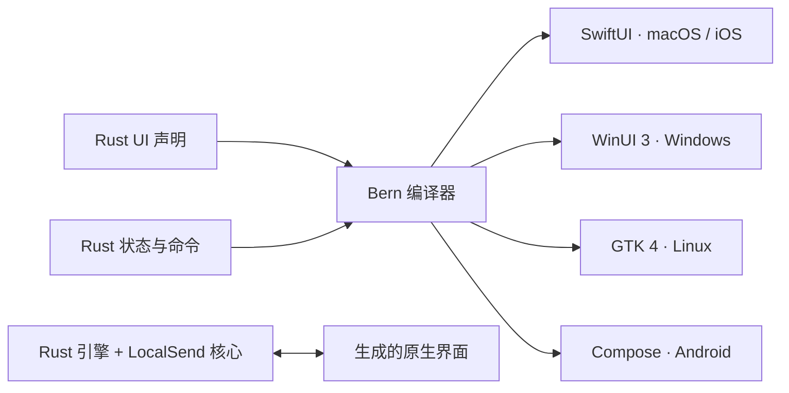

<div align="center">


<h1>RustSend</h1>

<p><b>完全 Rust 化的原生局域网传输工具。</b></p>

<p>小包体，轻内存，高性能。使用 <a href="https://github.com/AimesSoft/Bern">Bern</a> 开发，兼容 LocalSend。<br>
从界面声明到业务与传输逻辑，统一用 Rust 编写，让文件直接在你的设备之间流动。</p>

<p>

<a href="https://github.com/AimesSoft/Bern"></a>

</p>

<p>
<a href="https://github.com/AimesSoft/RustSend/releases"></a>
<a href="https://github.com/AimesSoft/RustSend/actions/workflows/release.yml"></a>
<a href="LICENSE"></a>

</p>

<p><b>简体中文</b> · <a href="README.en.md">English</a></p>

<p>
<a href="https://github.com/AimesSoft/RustSend/releases/latest">下载</a> ·
<a href="#为什么是-rustsend">为什么是 RustSend</a> ·
<a href="#实测数据">实测数据</a> ·
<a href="#从源码构建">从源码构建</a> ·
<a href="docs/releases/1.0.0.md">1.0 更新内容</a>
</p>

</div>

## 为什么是 RustSend

| | RustSend 的做法 |
| --- | --- |
| **完全 Rust 化** | 界面声明、状态、命令、业务逻辑和传输核心均使用 Rust。构建无需 Flutter 或 Dart。 |
| **Bern 原生界面** | Bern 在构建时将 Rust 声明生成 SwiftUI、WinUI 3、GTK 4 和 Jetpack Compose 界面，按钮、表单、选择器采用平台控件。 |
| **小包体、轻内存** | 复用系统 UI，Release 构建开启优化、LTO 与符号剥离；紧凑窗口只保留当前操作需要的内容。 |
| **高性能传输** | Rust + Tokio 异步处理网络和磁盘，流式读写文件并计算 SHA-256，传输不会把整个文件一次性读入内存。 |
| **兼容 LocalSend** | 复用 LocalSend 的 Rust 协议核心，支持 LocalSend v2 局域网发现与文件互传。 |
| **简单直接** | 无需账号或云服务器。同一局域网内选好文件、点选设备、确认接收。 |

RustSend 由 [AimesSoft](https://github.com/AimesSoft) 开发。它继承 LocalSend 的互通能力，以 Bern 重写应用层与界面：黑白灰原生控件、Rust 橙色 Logo，以及随桌面小窗和手机屏幕调整的布局。

## 实测数据

<!-- RELEASE_MEASUREMENTS: Replace this section with final 1.0.0 measurements before publication. -->
| 本地 Release 构建 | 体积 |
| --- | ---: |
| macOS ARM64 `.app` | 约 **8.1 MiB** |
| Android ARM64 `.apk` | 约 **17.3 MiB** |

以上为 2026-10-23 本地预发布版本的构建结果：macOS 统计完整应用包，Android 统计 APK 文件，均不包含调试符号。正式下载包包含的辅助工具、压缩方式与签名会影响最终体积。内存测量记录将在正式构建验证后补充。

## 能做什么

- **发现与连接**：自动发现同一局域网内的设备，也可手动输入地址，收藏常用设备。
- **文件与文字**：多文件、递归文件夹、空文件、Unicode 文件名、文字消息；显示传输进度并支持取消。
- **接收控制**：逐次确认、选择要接收的文件、快速保存、仅自动接收收藏设备、接收 PIN。
- **传输与保存**：TLS 加密、持久设备身份、流式 SHA-256 校验；同名文件自动编号，保留已有文件。
- **本地记录**：保留发送与接收历史，传输完成后显示应用内浮层提示，按钮和正文位置保持稳定。
- **原生交互**：桌面文件选择与拖放；Android 系统文件选择、打开已接收文件，以及通过系统文件夹选择器导出。
- **浏览器分享**：生成局域网下载链接，收到下载请求时在应用内确认。
- **自己的名字**：1,920 种昆虫与甲壳类组合，例如“悠闲的寄居蟹”“好奇的萤火虫”；一键换名或手动设置，重启后保留。
- **简洁外观**：中文／英文，系统／浅色／深色模式，旋转的 Rust 橙色 Logo。默认桌面窗口为 440 × 560，手机使用底部导航。

## 下载与使用

在 [GitHub Releases](https://github.com/AimesSoft/RustSend/releases/latest) 下载对应平台的文件。1.0 发行资产统一使用 `RustSend-版本-操作系统-架构` 命名。

| 平台 | 原生界面 | 1.0 发行包 |
| --- | --- | --- |
| macOS 14+ · Apple Silicon | SwiftUI | `RustSend-1.0.0-macOS-arm64.zip` |
| Windows · x64 | WinUI 3 | `RustSend-1.0.0-Windows-x64-setup.exe`、`RustSend-1.0.0-Windows-x64.zip` |
| Linux · x64 | GTK 4 + libadwaita | `RustSend-1.0.0-Linux-x64.deb`、`RustSend-1.0.0-Linux-x64.tar.gz` |
| Android 8.0+ · ARM64 | Jetpack Compose | `RustSend-1.0.0-Android-arm64.apk` |
| iOS 17+ · ARM64 | SwiftUI | `RustSend-1.0.0-iOS-arm64-unsigned.ipa` |

Linux 推荐 Ubuntu 24.04 或更新版本，通过 `.deb` 安装 GTK 4、libadwaita 与 WebKitGTK 6 等依赖。Windows 使用 Windows App Runtime 2.5。macOS 包采用临时签名、尚未公证；Windows 包未配置 Authenticode 签名。iOS 的 IPA 未签名，需要用自己的 Apple 开发者身份签名后安装；自动组播发现还需要 Apple 批准的组播权限，未授权时可通过手动 IP 连接。每次发布附带 `SHA256SUMS.txt`，可核对下载文件。

Android 的同名 `.dm` 是可选的启动优化配置，普通安装只需 APK。需要主动传输时请保持移动端应用在前台；Android 持续后台传输服务尚未接入。

1. 在两台设备上打开 RustSend，或在另一台设备上打开 LocalSend。
2. 连接同一局域网，在“发送”页选择文件或输入文字。
3. 点选对方设备，在接收端确认。需要时可在设置中开启快速保存。

如果自动发现不到设备，可使用手动地址连接，并检查网络是否允许设备互访。默认传输与发现端口为 `53317`。

## 使用 Bern 开发

RustSend 的应用代码由三部分组成：Rust 协议声明描述状态与命令，Rust 引擎实现传输与持久化，Rust UI 声明描述原生界面。Bern 编译器把同一份声明转换成各平台的 UI 代码，运行时直接调用 Rust 引擎。



这里的“完全 Rust 化”指开发者维护的应用界面声明、状态与业务代码全部使用 Rust；SwiftUI、C++/WinRT、Kotlin 等平台代码由 Bern 生成。Logo 的 SVG 动画通过 Bern 的平台适配显示。

本仓库在 `vendor/bern/` 固定保存 Bern 源码与本项目所需修复，从仓库直接构建即可，不依赖本机另外检出的框架目录。

## 从源码构建

安装 [Rust](https://rustup.rs/) 与目标平台的开发工具。仓库的 `rust-toolchain.toml` 固定 Rust 1.99.0，首次执行 Cargo 时会自动选择该版本。

```sh
git clone https://github.com/AimesSoft/RustSend.git
cd RustSend

# 构建仓库内固定版本的 Bern CLI
cargo build --manifest-path vendor/bern/Cargo.toml -p bern-cli --release

# 检查协议、翻译与 UI 声明
vendor/bern/target/release/bern check

# 在 macOS 上构建应用
vendor/bern/target/release/bern build --target macos --release
open target/bern/macos/RustSend.app
```

Windows 上使用 `vendor\bern\target\release\bern.exe`。将 `--target` 改为 `windows`、`linux`、`android` 或 `ios`，并在能构建该平台的主机上运行。构建产物位于 `target/bern/<target>/`。

| 目标 | 构建环境 |
| --- | --- |
| macOS | macOS、Xcode 26 或更新版本 |
| Windows | Windows、MSVC Rust 工具链、Visual Studio C++ 生成工具与 Windows SDK |
| Linux | GTK 4.14+、libadwaita 1.5+、WebKitGTK 6 开发包；推荐 Ubuntu 24.04+ |
| Android | JDK 21、Android SDK 37、NDK、Gradle 9.4+；`rustup target add aarch64-linux-android` |
| iOS | macOS、Xcode iOS SDK；`rustup target add aarch64-apple-ios`；设备包与签名步骤见 [1.0 发布说明](docs/releases/1.0.0.md) |

构建 iOS 真机应用时，设置设备目标和局域网权限说明：

```sh
BERN_IOS_DEVICE=1 \
BERN_IOS_LOCAL_NETWORK_DESCRIPTION='RustSend uses the local network to discover devices and transfer files.' \
vendor/bern/target/release/bern build --target ios --release
```

产物为 `target/bern/ios/RustSend.app`；CI 将其打包成未签名 IPA。此构建尚未完成 iOS 真机验收。

各平台 CI 的完整依赖与打包命令见 [Release workflow](.github/workflows/release.yml)。应用代码检查：

```sh
cargo fmt -p rustsend-engine -p rustsend-protocol -p rustsend-ui --check
cargo clippy -p rustsend-engine -p rustsend-protocol -p rustsend-ui --all-targets --no-deps -- -D warnings
cargo test -p rustsend-engine -- --test-threads=1
```

## 仓库结构

| 路径 | 内容 |
| --- | --- |
| `bern/ui/` | Rust UI 声明、翻译、紧凑布局和 Logo 资源 |
| `bern/protocol/` | 状态、数据类型和命令契约 |
| `bern/engine/` | Rust 业务引擎、设置、历史、文件操作与传输测试 |
| `packages/core/` | LocalSend 上游 Rust 协议核心 |
| `vendor/bern/` | 固定版本的 Bern 框架源码，使用 MIT 许可证 |
| `.github/workflows/release.yml` | 五个平台的构建与 GitHub Release 发布 |
| `docs/releases/` | 逐版本更新说明 |

推送与 `Bern.toml` 及应用 crate 版本一致的 `v1.0.0` 标签后，Release workflow 编译五个平台、生成统一命名的包与校验和，并使用对应版本的更新说明发布。手动运行默认只构建，显式选择发布时要求提交已经带有匹配的版本标签。

## 验证范围

macOS 与 Android 已完成实机双向传输、同名文件保存、SHA-256 一致性、紧凑布局、完成浮层及随机名称同步验证。自动测试覆盖真实 HTTPS 传输、部分接收、取消与拒绝、PIN、校验失败、路径穿越、浏览器下载确认和设置持久化。

其他平台的构建结果以对应 Release workflow 为准。Android 的系统选择器授权后导入、剪贴板及 SAF 导出已实现，端到端实机验收仍待补齐。当前应用未提供 LocalSend 的全部功能；跨网络 WebRTC、系统分享扩展、托盘／开机启动及更多语言仍在后续范围内。

## 开源协议与致谢

RustSend 使用与 [LocalSend](https://github.com/localsend/localsend) 相同的 [Apache License 2.0](LICENSE)。LocalSend 的 Rust 协议核心与 Logo 轮廓来自上游项目，保留其版权与许可证；RustSend Logo 在原轮廓上使用 Rust 橙色。上游版本、版权归属与第三方声明见 [NOTICE](NOTICE)。

[Bern](https://github.com/AimesSoft/Bern) 使用 [MIT 许可证](vendor/bern/LICENSE)。感谢 LocalSend、Bern 及所有依赖项目的贡献者。
