# RustSend 1.0.0 截图 / Screenshot gallery

[简体中文 README](../../README.md#界面预览) · [English README](../../README.en.md#screenshots)

以下图片采集于 2026-10-23，来自实际运行的 RustSend 1.0.0。截图保留应用的实际布局、控件和内容；macOS 取应用内容区，Windows 取窗口可见边界，手机保留完整屏幕。点击图片可查看原图。

Captured on 2026-10-23 from running RustSend 1.0.0 applications. Images retain the application's real layout, controls, and content. macOS captures show the application content area; Windows captures use the visible window bounds; mobile captures show the full screen. Click any image for its full-size version.

| 平台 / Platform | 环境 / Environment | 界面 / UI |
| --- | --- | --- |
| macOS | Apple Silicon 实机 / physical Mac · macOS 27.0.1 | SwiftUI |
| Windows | x64 实机 / physical PC · Windows 11 Pro 25H2 · 150% scaling | WinUI 3 |
| Linux | Ubuntu 24.04 ARM64 · VMware Fusion VM · GTK Broadway display | GTK 4 + libadwaita |
| Android | 小米 / Xiaomi MIX 2S 实机 / physical device · Android 15 · ARM64 | Jetpack Compose |
| iOS | iPhone 17 Pro simulator · iOS 26.5 · ARM64 | SwiftUI |

Windows 和 Android 使用公开 1.0.0 发行包；macOS 使用本地 1.0.0 Release 构建。Linux VM 为 ARM64，使用同一 `v1.0.0` 标签源码构建，与 Release 的 Linux x64 包架构不同。iOS 使用 1.0.0 模拟器 Release 构建；这组截图不代表 iOS 真机验收。

Windows and Android use the public 1.0.0 packages; macOS uses the local 1.0.0 Release build. The Linux VM is ARM64 and was built from the same `v1.0.0` tag, whereas the public Linux package targets x64. iOS uses a 1.0.0 simulator Release build; these captures do not constitute physical-device validation.

## 桌面接收 / Desktop receiving

| macOS | Windows | Linux |
| --- | --- | --- |
| [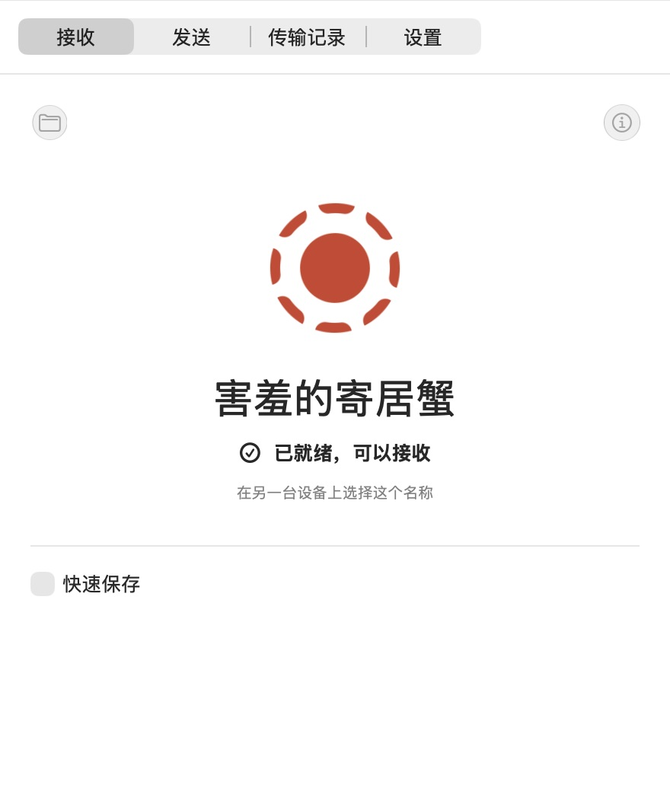](macos-receive.png) | [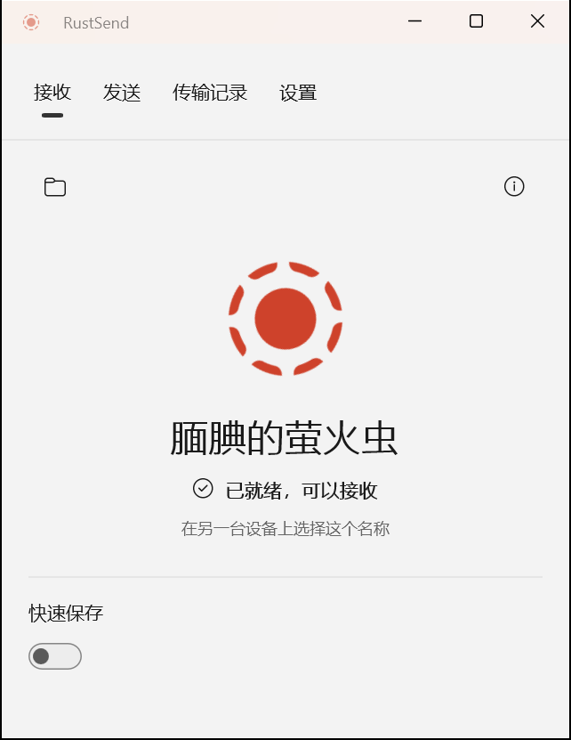](windows-receive.png) | [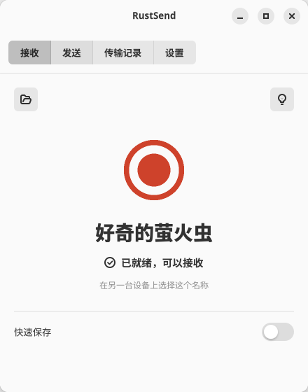](linux-receive.png) |

## 发送与设备发现 / Sending and device discovery

macOS 画面中的 iOS、Windows 和 Android 均为本次截图时实际运行的设备。Android 接收示例传输的是本项目公开的 `README.md`。

The iOS, Windows, and Android peers shown on macOS were running during this capture. The Android receive example transfers this project's public `README.md`.

| macOS | Linux |
| --- | --- |
| [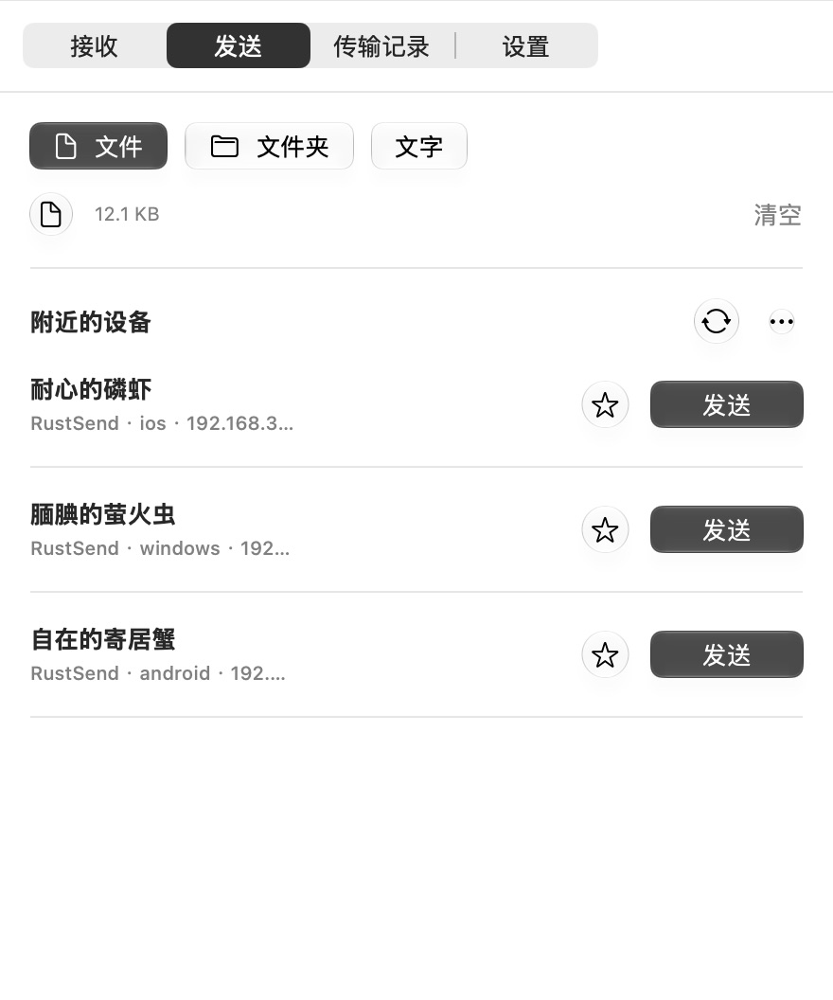](macos-send.png) | [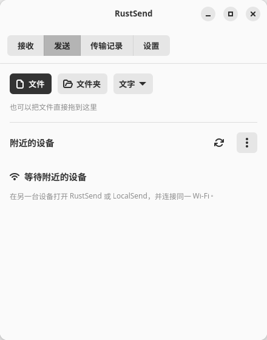](linux-send.png) |

## Android 接收流程 / Android receive flow

| 接收就绪 / Ready | 确认文件 / Approve files | 应用内完成提示 / In-app completion |
| --- | --- | --- |
| [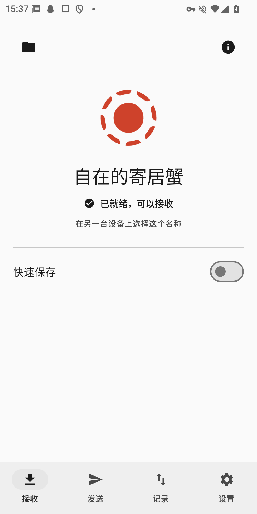](android-receive.png) | [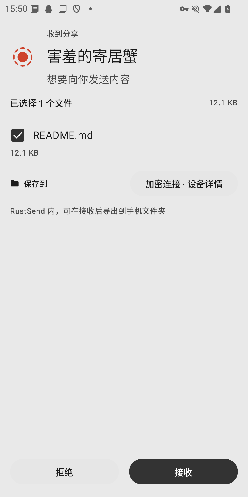](android-receive-request.png) | [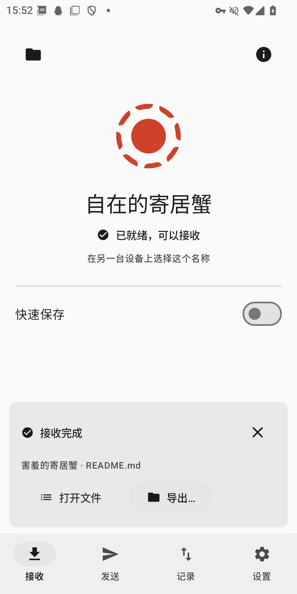](android-transfer-complete.png) |

## iOS 与原生设置 / iOS and native settings

| iOS 接收 / Receive | iOS 设置 / Settings | Windows 设置 / Settings |
| --- | --- | --- |
| [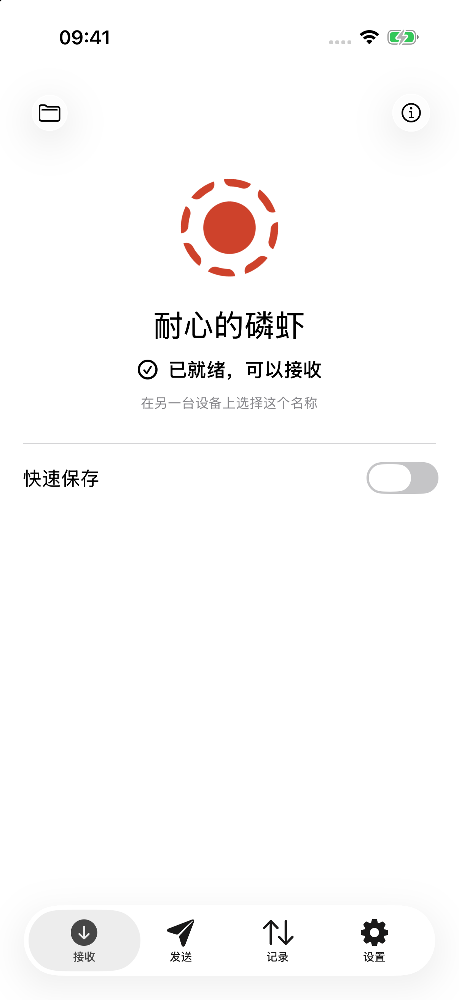](ios-receive.png) | [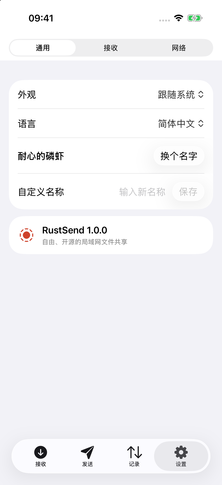](ios-settings.png) | [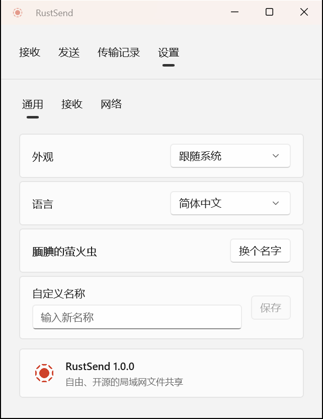](windows-settings.png) |

## 更新截图 / Updating the captures

使用相同版本运行各平台应用，再通过系统截屏或框架的原生窗口快照替换对应 PNG；保留各平台真实比例，同时更新上面的版本、日期与环境信息。截图中的演示文件应使用公开内容。

Run the same application version on each platform, then replace the matching PNG using a system screenshot or the framework's native window snapshot. Preserve each platform's aspect ratio and update the version, date, and environment notes above. Use public content for demonstration files.
